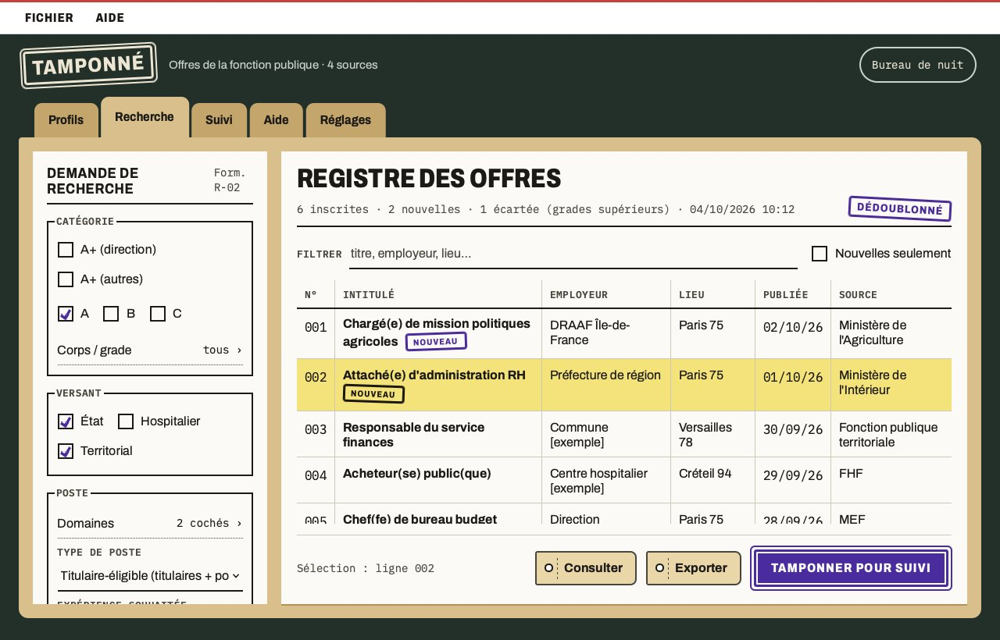
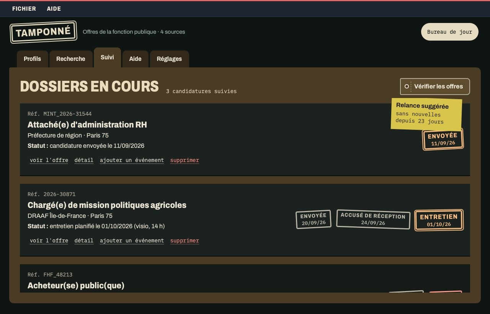

# Tamponné

_« Les postes publics, enfin au même endroit. »_

Application de bureau pour rechercher des offres d'emploi de la fonction publique, multi-source ([choisirleservicepublic.gouv.fr](https://choisirleservicepublic.gouv.fr), [emploi-territorial.fr](https://www.emploi-territorial.fr), Passerelles/MEF, FHF), avec fiches de recherche sauvegardées et suivi de candidature, dans une interface « dossier administratif » (bureau de jour ou de nuit).





## Prérequis

- [Python 3.14+](https://www.python.org/downloads/)
- [uv](https://docs.astral.sh/uv/getting-started/installation/) — gestionnaire de paquets Python

Installation uv (si absent) :

**macOS/Linux** :

```bash
curl -LsSf https://astral.sh/uv/install.sh | sh
```

**macOS (Homebrew)** :

```bash
brew install uv
```

**Windows** :

```bash
winget install astral-sh.uv
```

## Installation et lancement

Téléchargez le zip depuis la page [Releases](https://codeberg.org/Kwaite/tamponne/releases) (lien « Source code (zip) » de la dernière version), puis dézippez-le.

Dans le dossier obtenu :

| Système       | Commande      |
| ------------- | ------------- |
| macOS / Linux | `./lancer.sh` |
| Windows       | `lancer.bat`  |

> **macOS/Linux** : si le terminal répond `permission denied`, le bit exécutable n'a pas été conservé à la décompression — lancez `chmod +x lancer.sh` une fois, puis relancez `./lancer.sh`.

`uv sync` installe automatiquement le virtualenv et les dépendances au premier lancement. Ces deux scripts appliquent aussi les mises à jour en attente (voir plus bas) — c'est la façon recommandée de lancer l'app.

```bash
# Ou manuellement (toutes plateformes) — pas de mise à jour automatique dans ce cas
uv sync
uv run python -m src.gui.application
```

**Dépendances** : `PySide6` (interface Qt Quick/QML), `beautifulsoup4` (parsing HTML). Polices embarquées : [Archivo](https://fonts.google.com/specimen/Archivo) et [IBM Plex Mono](https://github.com/IBM/plex), sous licence SIL OFL 1.1 (`src/gui/qml/Tamponne/polices/`).

## Fonctionnalités

- **Multi-source** — choisirleservicepublic.gouv.fr, emploi-territorial.fr, Passerelles/MEF, FHF, chacune activable depuis Réglages › Sources consultées ; dédoublonnage automatique des offres communes
- **Demande de recherche** — catégorie (dont A+), corps et grade (Attaché, Adjoint administratif), versant, domaines, type de poste, expérience, date de publication, localisations, organisations, management, télétravail, grades supérieurs, mot-clé libre
- **Fiches de recherche** — classer une demande, la lancer, la modifier, la dupliquer ou la supprimer depuis l'onglet Profils
- **Nouvelles offres** — à chaque lancement d'une fiche, les offres jamais vues pour elle portent le tampon « Nouveau » dans le registre, avec un filtre pour ne voir qu'elles
- **Registre des offres** — pagination complète (jusqu'à 20 pages par source), tri par colonne, filtre en direct, export HTML des offres affichées
- **Filtre grades supérieurs** — offres IDIV/IP/AFIPA écartées par défaut, réintégrables
- **Suivi de candidature** — dossiers tamponnés depuis le registre avec fiche de poste archivée en PDF, historique d'événements modifiable, relance suggérée après 3 semaines sans nouvelles, vérification des offres dépubliées
- **Accessibilité** — contrastes WCAG AA vérifiés par les tests, navigation au clavier, éléments exposés aux lecteurs d'écran, option « Réduire les animations »
- **Cache organisations** — liste des ministères et sous-organisations mise en cache 7 jours, rafraîchissable depuis Réglages
- **Mise à jour automatique** — voir ci-dessous

## Mise à jour automatique

Au lancement, l'app vérifie en arrière-plan s'il existe une publication ([Releases](https://codeberg.org/Kwaite/tamponne/releases) Codeberg) plus récente que la version installée — jamais un `git pull` sur une branche, uniquement ce qui a été explicitement publié.

- Une mise à jour disponible se signale par un point rouge sur l'onglet « Réglages », où l'avis de mise à jour présente la nouvelle version et ses notes ; sinon l'avis indique que la version installée est à jour.
- Par défaut, elle s'applique automatiquement **au prochain lancement**, sans action requise (« Au prochain lancement » efface simplement le point rouge).
- « Installer et redémarrer » l'applique **immédiatement** : l'app se ferme et relance toute seule.
- Les fichiers retirés d'une version à l'autre sont supprimés à l'installation ; vos données (`data/`) ne sont jamais touchées.

Ce mécanisme repose sur `lancer.sh`/`lancer.bat` (voir ci-dessus) — un lancement via `uv run python -m src.gui.application` en direct affiche l'avis mais n'applique rien tant que l'un de ces deux scripts n'est pas utilisé au moins une fois.

## Architecture

```
src/
  gui/
    application.py           point d'entrée : moteur QML, vérification de mise à jour
    app.py                   ancien point d'entrée (lanceurs 1.0.x), délègue à application
    pont.py                  objet unique exposé au QML (contrôleurs)
    controleur_*.py          un contrôleur par écran : Profils, Recherche, Suivi, Réglages
    presentation.py          textes affichés, calculés sans Qt
    modele_offres.py         registre : modèle, tri et filtres
    modele_registre.py       colonnes du registre des offres
    travailleurs.py          tâches réseau sur QThread (recherche, vérifications)
    qml/Tamponne/            interface QML : Theme.qml (couleurs jour/nuit), écrans,
                             dialogues, composants, polices embarquées
  sources/
    base.py                  Protocol commun aux sources d'offres + dédoublonnage
    choisirleservicepublic/  requêtes GET filtrées + parsing HTML (BeautifulSoup4)
    emploiterritorial/       portail légal CDG/CNFPT (FPT)
    passerellesmef/          portail Talentsoft des ministères économiques et financiers
    fhf/                     portail de la Fédération Hospitalière de France (FPH)
  recherche.py               orchestration multi-source (sans Qt)
  cache.py                   cache organisations (7 j) + offres vues par fiche (30 j)
  candidatures.py            suivi de candidature
  filtres.py                 constantes IDs API (catégories, grades, versants, domaines, localisations)
  parametres_sources.py      sources actives/inactives
  parametres_affichage.py    thème et réduction des animations
  profils.py                 fiches de recherche sauvegardées
  maj.py                     vérification/application des mises à jour (publications Codeberg)
  nettoyage.py               retrait des fichiers de l'ancienne interface après mise à jour
  export.py                  export HTML inline
  utils.py                   écriture JSON atomique
  types.py                   structures de données partagées (TypedDict)
data/
  profils.json               fiches de recherche
  candidatures.json          suivi de candidature
  cache.json                 cache organisations
  offres.json                offres vues par fiche
  sources.json               sources actives/inactives
  affichage.json             thème et animations
  maj_disponible.json        marqueur de mise à jour en attente
  archives/                  archives PDF des offres suivies
exports/                     fichiers HTML générés
outils/
  maquette/                  maquette de référence (HTML)
  comparer_maquette.py       comparaison visuelle maquette / application
docs/captures/               captures d'écran du README
```

## API

`choisirleservicepublic.gouv.fr` utilise WordPress avec un endpoint AJAX (`admin-ajax.php`, action `get_offers`) pour la **première page uniquement** — le serveur ignore le paramètre de pagination AJAX. La pagination réelle se fait via des **requêtes GET** sur des URLs WordPress au format rewrite :

```
GET /nos-offres/filtres/localisation/284/domaine/3522/versant/2456/categorie/1805/type/4534-2349/
GET /nos-offres/filtres/localisation/284/domaine/3522/versant/2456/categorie/1805/type/4534-2349/page/2/
```

Le mapping paramètres → segments URL est documenté dans `RECHERCHES.md` (spécifique à ce site).

## Filtres disponibles

| Filtre                   | Valeurs                                                          |
| ------------------------ | ---------------------------------------------------------------- |
| Catégorie                | A+ (direction), A+ (autres emplois fonctionnels), A, B, C        |
| Corps / grade            | Attaché (principal, hors classe), Adjoint administratif (principal de 2e et 1re classe) |
| Versant                  | État (défaut), Hospitalier, Territorial — cumulables, aucun = tous |
| Type de poste            | Titulaire-éligible (défaut), Titulaire, Contractuel, Tous        |
| Domaine                  | 29 domaines métier (Numérique, Finances Publiques, etc.)         |
| Localisation             | 114 départements/régions                                         |
| Organisation             | scrapées automatiquement (ministères et sous-organisations)      |
| Expérience               | Débutant, Confirmé, Expert                                       |
| Date de publication      | Dernières 48 heures, 7 derniers jours, 14 derniers jours         |
| Management / Télétravail | Basculables indépendamment                                       |
| Grades supérieurs        | Écartés par défaut (IDIV, IP, AFIPA), réintégrables              |

Filtre Corps / grade : reconnaissance par mots-clés dans le titre, appliquée côté client après agrégation — aucune source n'expose ce niveau de granularité côté serveur. Catégorie/Localisation/Expérience/Management/Télétravail sont eux câblés côté serveur sur emploi-territorial.fr (voir `src/sources/emploiterritorial/filtres.py`), en plus de choisirleservicepublic.gouv.fr.

## Développement

```bash
uv sync                    # inclut le groupe dev (pytest, mypy...) par défaut
uv run pytest -q           # suite de tests (pytest-qt, offscreen)
uv run mypy                # typage
uv run pyside6-qmllint -I src/gui/qml src/gui/qml/Tamponne/*.qml
uv run python -m outils.comparer_maquette recherche   # maquette / application, jour et nuit
```

## Données

- `RECHERCHES.md` — notes de reverse engineering de l'API choisirleservicepublic.gouv.fr
- `outils/maquette/` — maquette de référence de l'interface
